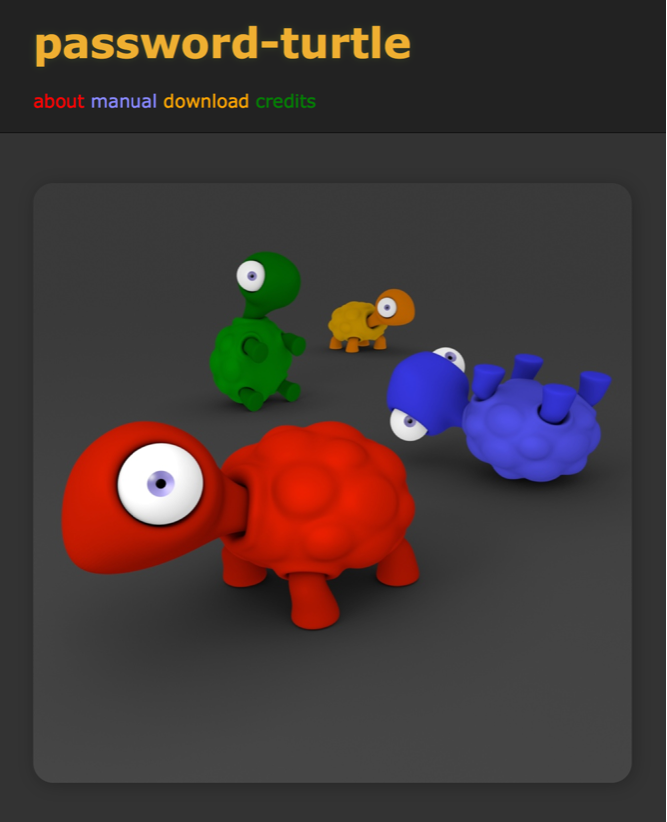

[](https://monsterkodi.github.io/password-turtle/)

## password-turtle

A password generator that derives passwords from a master key, a site and a
pattern. The master key never leaves the machine: the stash file is encrypted
with it, and the password is recomputed from the key every time.

## Running it on linux

The app was written for macOS. On linux a few things need attention:

```
pnpm install          # installs the dependencies and the electron binary
pnpm build            # compiles coffee/ -> js/ and style/*.styl -> style/*.css
pnpm start            # runs the app
pnpm test             # runs the unit tests
```

`pnpm start` runs `electron . --ozone-platform=x11 --force-device-scale-factor=2`,
and both flags matter:

* Chromium's **native wayland backend does not share the clipboard** with the
  desktop on this machine, so "password copied" would copy nothing. Under x11
  (xwayland) the selection is bridged to wayland by the compositor and both
  directions work.
* Xwayland does not know about the scale factor of the output, so chromium
  draws the window at 1:1 and it comes out tiny. `--force-device-scale-factor=2`
  makes the window twice as big. A different factor can be passed on the
  command line, the last one wins:
  `pnpm start --force-device-scale-factor=1.5`.
* The ozone platform and the scale factor are chosen before the app's code
  runs, so the flags have to be on the command line - `app.commandLine.appendSwitch()`
  comes too late. The app prints a warning when it is started without them.

The window is a small frameless panel (364x360, 364x491 with the settings
open). Compositors that tile windows stretch it, so it should float. For
hyprland, add this to `~/.config/hypr/apps.lua`:

```lua
o.window("^password-turtle$", {
  float = true,
})
```

Do not add `no_screen_share` to that rule: it keeps the xwayland client from
painting its content, and the window stays black.

The window does not hide itself when it loses the focus - that is what a menu
bar extra does on macos, but here it just makes the app unusable. Press `esc`
to hide it, or use the global shortcut (`ctrl+F3` by default), which toggles
it: it shows and focuses the window, and hides it again when it is already
there.

The password is written by the main process: to the x11 selection and, on a
wayland desktop, with `wl-copy`. The x11 selection of an xwayland client only
reaches the wayland clipboard when some wayland client owned it before, so
without `wl-copy` the copy would get lost whenever the wayland clipboard was
empty. `wl-copy` gets the text on stdin, it does not show up in the process
list.

To start the app from the desktop, use the launcher in `password-turtle.desktop`
(copy it to `~/.local/share/applications/`).

## How the passwords are made

`password.make` walks through the characters of the pattern. Every character
of the pattern selects a character set (letters, digits, `-`, `.`, ...), and
the character that goes into the password is picked from that set with a sum
over the sha512 hash of site and master key. Same master key, same site, same
pattern - same password. No password is ever stored.

The stash file (`~/.config/password-turtle/password-turtle.stash`) holds the
pattern and the sites that were remembered, encrypted with aes-256-cbc. The
key and the iv are derived from the master key the way openssl's
`EVP_BytesToKey` did it, so stash files written by older versions of this app
can still be read.
